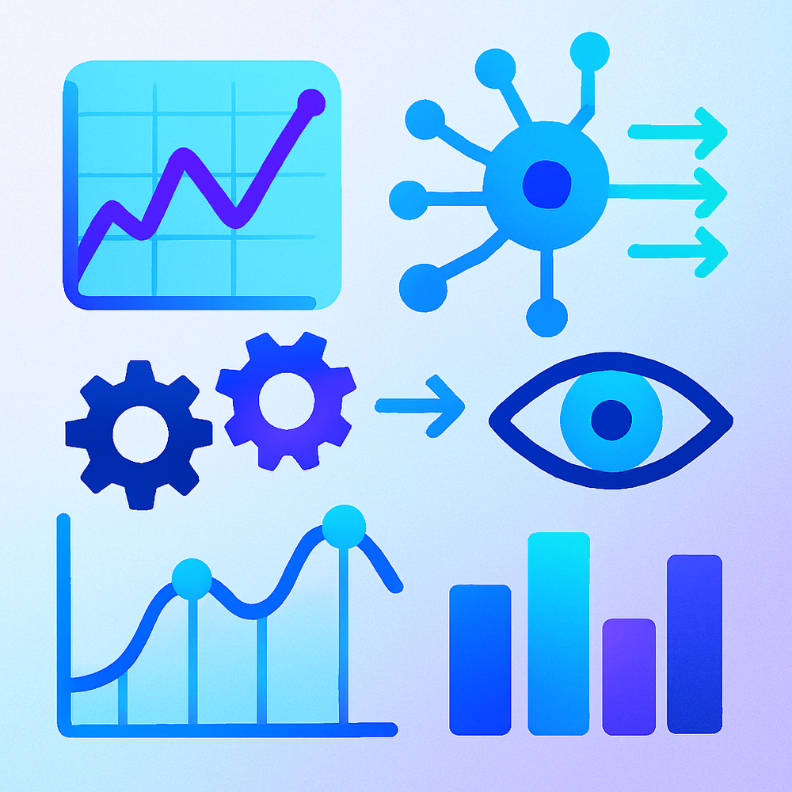
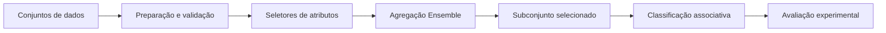

<!--
  README DO PERFIL • VINICIUS DE SOUZA SANTOS
  Repositório: https://github.com/ViniciusKanh/ViniciusKanh
  Esta versão usa imagens REAIS já existentes em repositórios públicos.
  Para publicar: substitua somente o README.md do repositório de perfil.
  Algumas imagens e estatísticas dependem de provedores externos.
-->

 

 

  

  

  

**[Sobre mim](#-sobre-mim)** · **[Laboratório visual](#-laboratório-visual)** · **[Projetos](#-projetos-em-destaque)** · **[Artigos](#-publicações-científicas-e-produção-acadêmica)** · **[Tecnologias](#-arsenal-tecnológico)** · **[Estatísticas](#-estatísticas-do-github)** · **[Contato](#-vamos-construir-algo-juntos)**

---

## 👨‍💻 Sobre mim

Sou **Vinicius de Souza Santos**, engenheiro da computação, **mestrando em Ciência da Computação pela UNESP** e profissional de **Ciência de Dados, Machine Learning, Inteligência Artificial Generativa e Engenharia de Software**.

Minha atuação reúne dois ambientes complementares: **a pesquisa científica**, na investigação de algoritmos, modelos e protocolos experimentais; e **o desenvolvimento aplicado**, na construção de plataformas, APIs, automações, dashboards, agentes e ferramentas de análise.

- 🔬 **Pesquisa:** seleção de atributos (*Ensemble Feature Selection*), classificação associativa, avaliação e interpretabilidade de modelos.
- 🧠 **Machine Learning:** classificação, regressão, calibração, desbalanceamento, validação e análise de erros.
- 🤖 **IA Generativa:** Transformers, LLMs, RAG, multimodalidade, aplicações locais e integração de modelos.
- 📊 **Dados e Analytics:** Python, SQL, pipelines de ETL, Power BI, modelagem e qualidade de dados.
- ⚙️ **Engenharia de software:** FastAPI, React/TypeScript, Docker, integrações REST e automação de processos.

> **Minha missão:** transformar pesquisa e dados em sistemas reproduzíveis, interpretáveis e úteis — sem confundir uma demonstração promissora com uma evidência científica validada.

 

### 🎯 O que conecta meus trabalhos?

| 📚 Pesquisa | 🧠 Modelagem | 🏗️ Engenharia | 📈 Impacto |
| :---: | :---: | :---: | :---: |
| Problemas, hipóteses e literatura | Algoritmos, dados e avaliação | APIs, interfaces e automação | Decisões, produtos e conhecimento |
| **Rigor metodológico** | **Modelos interpretáveis** | **Sistemas utilizáveis** | **Resultados verificáveis** |

---

## 🎬 Laboratório visual

**Imagens e demonstrações reais dos meus repositórios públicos.** Selecione um projeto para acessar arquitetura, código, metodologia e instruções de execução. A aparência e as funcionalidades mostradas correspondem às demonstrações documentadas pelos respectivos projetos.

<table>
  <tr>
    <td width="50%" align="center" valign="top">
      
       <strong>🎨 IGNIS Multimodal</strong> Estúdio de geração e edição com IA.
    </td>
    <td width="50%" align="center" valign="top">
      
       <strong>📊 Predictive BI</strong> Analytics, predição e orquestração com n8n.
    </td>
  </tr>
  <tr>
    <td width="50%" align="center" valign="top">
      
       <strong>🧪 Neurix</strong> Workbench para exploração e avaliação de ML.
    </td>
    <td width="50%" align="center" valign="top">
      
       <strong>🌎 MERCOSUL Energy ML</strong> Pesquisa sobre trajetórias de descarbonização.
    </td>
  </tr>
</table>

  Os GIFs e gráficos acima foram referenciados diretamente de arquivos dos repositórios, sem criação de métricas ou resultados artificiais.

---

## 🌟 Projetos em destaque

### 🔥 01 · IGNIS — Pesquisa em modelos de linguagem e IA multimodal

<table>
  <tr>
    <td width="36%" align="center" valign="middle">
      
    </td>
    <td width="64%" valign="top">
      <h3><a href="https://github.com/ViniciusKanh/Ignis_30M">Ignis-30M + Ignis Studio</a></h3>
      
<strong>Modelo de linguagem autoral e ambiente experimental GenAI.</strong> Implementação e treinamento de um Transformer <em>decoder-only</em> de <strong>30.416.384 parâmetros</strong>, acompanhada de um Studio com conversação, consulta a documentos e API.

      
<strong>Contribuição técnica:</strong> arquitetura e treinamento do modelo próprio, experimentação em português, integração de recuperador e interface.

      
<code>PyTorch</code> <code>Transformer</code> <code>Python</code> <code>Gradio</code> <code>RAG</code>

      
🔗 <a href="https://github.com/ViniciusKanh/Ignis_30M">Repositório</a> · <a href="https://huggingface.co/ViniciusKhan/Ignis-30M">Modelo no Hugging Face</a> · <a href="https://huggingface.co/spaces/ViniciusKhan/Ignis-30M-Demo">Studio</a>

    </td>
  </tr>
</table>

> **Transparência experimental:** o Ignis-30M é um modelo de pesquisa. O Studio também utiliza Qwen e modelos de recuperação externos. As respostas do aplicativo não constituem resultados de benchmark dos pesos próprios do Ignis-30M.

<table>
  <tr>
    <td width="36%" align="center" valign="middle">
      
    </td>
    <td width="64%" valign="top">
      <h3><a href="https://github.com/ViniciusKanh/IGNIS-llm-Multimodal">IGNIS Multimodal</a></h3>
      
<strong>Laboratório de visão e geração de imagens.</strong> Combina modelos públicos de visão-linguagem e difusão, interface moderna e um pipeline experimental de adaptação <strong>LoRA</strong>.

      
<strong>Contribuição técnica:</strong> orquestração, interface, APIs, treinamento de adaptador de imagem e experimentos comparativos.

      
<code>FastAPI</code> <code>React</code> <code>TypeScript</code> <code>Diffusion</code> <code>LoRA</code>

      
🔗 <a href="https://github.com/ViniciusKanh/IGNIS-llm-Multimodal">Repositório</a> · <a href="https://huggingface.co/ViniciusKhan/ignis-image-lora-v1">Adaptador publicado</a> · <a href="https://huggingface.co/spaces/ViniciusKhan/IGNIS-Image-Lab">Space</a>

    </td>
  </tr>
</table>

  
<strong>🖼️ Abrir mais imagens do IGNIS Multimodal</strong>

   
  <table>
    <tr>
      <td width="50%"> Comparação entre modelo-base e adaptador.</td>
      <td width="50%"> Recursos de edição e histórico.</td>
    </tr>
  </table>

### 🤖 02 · IA Generativa aplicada, RAG e sistemas inteligentes

<table>
  <tr>
    <td width="50%" valign="top">
      <h3>📚 <a href="https://github.com/ViniciusKanh/Aethra">Aethra — Document AI</a></h3>
      
<strong>Assistente documental com evidências verificáveis.</strong> Consulta a PDFs, DOCX e outros documentos; recupera trechos com RAG e oferece histórico privado de conversas e integração de leitura com Google Drive.

      
<strong>Stack:</strong> FastAPI · LangChain · Chroma · Ollama · React · Turso.

      
📎 <a href="https://github.com/ViniciusKanh/Aethra">Arquitetura, documentação e código</a>

    </td>
    <td width="50%" valign="top">
      <h3>🧩 <a href="https://github.com/ViniciusKanh/Analytical-Company">Analytical Company</a></h3>
      
<strong>Assistente analítico com SQL e recuperação semântica.</strong> Aplicação para consultar dados empresariais em linguagem natural, combinando consultas SQL, bases documentais e um orquestrador de IA.

      
<strong>Stack:</strong> Python · SQLite · ChromaDB · Ollama · RAG.

      
📎 <a href="https://github.com/ViniciusKanh/Analytical-Company">Arquitetura e implementação</a>

    </td>
  </tr>
  <tr>
    <td width="50%" valign="top">
      <h3>💬 <a href="https://github.com/ViniciusKanh/Senticore">Senticore</a></h3>
      
<strong>API de análise de sentimentos.</strong> Processamento de feedbacks e textos de relacionamento com clientes, com classificação em polaridades e retorno de pontuação.

      
<strong>Stack:</strong> FastAPI · Transformers · Hugging Face · NLP.

      
📎 <a href="https://github.com/ViniciusKanh/Senticore">Código e exemplos</a>

    </td>
    <td width="50%" valign="top">
      <h3>🚨 <a href="https://github.com/ViniciusKanh/ChurnSentinel">ChurnSentinel</a></h3>
      
<strong>Identificação de sinais textuais de risco de evasão.</strong> Analisa manifestações presentes em feedbacks, chamados e outras interações com clientes.

      
<strong>Stack:</strong> NLP · BERT · classificação supervisionada · FastAPI.

      
📎 <a href="https://github.com/ViniciusKanh/ChurnSentinel">Repositório</a>

    </td>
  </tr>
</table>

### 📊 03 · Predictive BI — Analytics, Engenharia de Dados e Machine Learning

  

O **[Predictive BI](https://github.com/ViniciusKanh/Predictive-BI-n8n-workflows)** é uma plataforma demonstrativa de análise de dados com navegação por indicadores, modelagem preditiva, avaliação, qualidade de dados e um backend orquestrado visualmente por **n8n**.

**Arquitetura:** entrada e validação de dados → transformação/ETL → indicadores → execução de modelos em Python → evidências → API/workflows → interface React. O repositório documenta a utilização de **dados sintéticos**.

<table>
  <tr>
    <td width="50%" align="center"> Previsão e avaliação temporal.</td>
    <td width="50%" align="center"> Backend orquestrado no n8n.</td>
  </tr>
  <tr>
    <td width="50%" align="center"> Risco de evasão e explicabilidade.</td>
    <td width="50%" align="center"> Qualidade, verificações e reconciliação.</td>
  </tr>
</table>

<strong>📎 <a href="https://github.com/ViniciusKanh/Predictive-BI-n8n-workflows">Conhecer a plataforma, os sete workflows e o guia de utilização</a></strong>

### 🔬 04 · Pesquisa científica e bibliotecas de Machine Learning

<table>
  <tr>
    <td width="50%" valign="top">
      <h3>🩸 <a href="https://github.com/ViniciusKanh/AnemiaClassifierML">AnemiaClassifierML</a></h3>
      
<strong>Triagem fenotípica baseada em hemograma completo.</strong> Estudo de classificação com tratamento de desbalanceamento, calibração probabilística, limiares, abstenção e interpretabilidade.

      
<code>Python</code> <code>scikit-learn</code> <code>XGBoost</code> <code>SHAP</code>

      
🔗 <a href="https://github.com/ViniciusKanh/AnemiaClassifierML">Protocolo e experimentos</a>

      
<em>Uso científico/experimental; não é uma ferramenta de diagnóstico clínico.</em>

    </td>
    <td width="50%" valign="top">
      <h3>🧬 <a href="https://github.com/ViniciusKanh/itmofs-lab">itmofs-lab</a></h3>
      
<strong>Biblioteca para Feature Selection.</strong> Interface consistente para métodos da ITMO_FS, inspeção de parâmetros e suporte a estudos reprodutíveis de seleção de atributos.

      
<code>Python</code> <code>Feature Selection</code> <code>ITMO_FS</code>

      
🔗 <a href="https://github.com/ViniciusKanh/itmofs-lab">Código</a> · <a href="https://pypi.org/project/itmofs-lab/">PyPI</a>

      

    </td>
  </tr>
  <tr>
    <td width="50%" valign="top">
      <h3>📦 <a href="https://github.com/ViniciusKanh/auto-ensemble-benchmark">auto-ensemble-benchmark</a></h3>
      
<strong>Comparação padronizada de ensembles.</strong> Avaliação de classificadores, rankings por métricas, agregação e validação cruzada para benchmarks reproduzíveis.

      
<code>Python</code> <code>scikit-learn</code> <code>Cross-validation</code>

      
🔗 <a href="https://github.com/ViniciusKanh/auto-ensemble-benchmark">Repositório</a> · <a href="https://pypi.org/project/auto-ensemble-benchmark/">PyPI</a>

      

    </td>
    <td width="50%" valign="top">
      <h3>🌱 <a href="https://github.com/ViniciusKanh/agroyield-risk-ml">AgroYield Risk ML</a></h3>
      
<strong>Risco de quebra de produtividade agrícola.</strong> Pesquisa que relaciona dados agrícolas públicos e variáveis climáticas para classificação interpretável do risco de redução do rendimento da soja.

      
<code>Python</code> <code>IBGE</code> <code>NASA POWER</code> <code>ML</code>

      
🔗 <a href="https://github.com/ViniciusKanh/agroyield-risk-ml">Dados e metodologia</a>

    </td>
  </tr>
</table>

### 🌎 05 · MERCOSUL — Machine Learning aplicado à transição energética

Pesquisa sobre **trajetórias de descarbonização em países do MERCOSUL e associados**, que combina indicadores públicos, preparação e exploração de dados, agrupamento, classificação e análise interpretável. O estudo foi desenvolvido para submissão ao **Prêmio MERCOSUL de Ciência e Tecnologia 2026**.

<table>
  <tr>
    <td width="50%" align="center"> Caracterização de agrupamentos.</td>
    <td width="50%" align="center"> Importância de atributos na modelagem.</td>
  </tr>
</table>

**Metodologia:** indicadores energéticos → auditoria e engenharia de atributos → análise exploratória → agrupamento → modelos interpretáveis → visualização dos resultados.

**📎 [Explorar código, dados, metodologia e figuras científicas](https://github.com/ViniciusKanh/mercosul-energy-transition-ml)**

### 🧪 06 · Neurix e CleanSight — Ferramentas para quem trabalha com dados

<table>
  <tr>
    <td width="50%" valign="top">
      
      <h3>🧪 <a href="https://github.com/ViniciusKanh/Neurix">Neurix</a></h3>
      
Workbench de Machine Learning com exploração de dados, treinamento, comparação de modelos, AutoML e análises determinísticas. <strong>Não depende de LLMs externos</strong> para executar as rotinas de ML documentadas.

      
<code>React</code> <code>Vite</code> <code>ML</code> <code>Turso</code>

    </td>
    <td width="50%" valign="top">
      
      <h3>🧹 <a href="https://github.com/ViniciusKanh/CleanSight">CleanSight</a></h3>
      
Plataforma visual de exploração e pré-processamento, com limpeza, identificação de valores ausentes, tratamento de variáveis, análises e exportação de datasets preparados para modelagem.

      
<code>Python</code> <code>Flask</code> <code>React</code> <code>Preprocessing</code>

    </td>
  </tr>
</table>

  
<strong>📸 Abrir galeria do Neurix e CleanSight</strong>

   
  <table>
    <tr>
      <td width="50%"> Neurix • AutoML</td>
      <td width="50%"> Neurix • Regras de associação</td>
    </tr>
    <tr>
      <td width="50%"> CleanSight • Importação de dados</td>
      <td width="50%"> CleanSight • Distribuições</td>
    </tr>
  </table>

### 📱 07 · Produtos e aplicações completas

<table>
  <tr>
    <td width="50%" valign="top">
      
      <h3>🗓️ <a href="https://github.com/ViniciusKanh/LifeOs">LifeOS</a></h3>
      
Plataforma pessoal de produtividade, metas, estudos e hábitos, com visualizações de dados, funcionalidades de IA, persistência e versões web/desktop documentadas.

      
<code>React</code> <code>TypeScript</code> <code>Express</code> <code>Turso</code>

      
🔗 <a href="https://lifeos-sigma-five.vercel.app">Acessar aplicação</a> · <a href="https://github.com/ViniciusKanh/LifeOs">Código</a>

    </td>
    <td width="50%" valign="top">
      
      <h3>💳 <a href="https://github.com/ViniciusKanh/Monvy">Monvy</a></h3>
      
Aplicação de gestão e visualização financeira, com dashboard, lançamentos e relatórios organizados em uma interface de acompanhamento.

      
🔗 <a href="https://github.com/ViniciusKanh/Monvy">Funcionalidades e telas</a>

    </td>
  </tr>
  <tr>
    <td width="50%" valign="top">
      <h3>🧑‍💼 <a href="https://github.com/ViniciusKanh/RecrAI">RecrAI</a></h3>
      
Sistema de apoio à triagem de currículos e avaliação de aderência a vagas, com critérios de pontuação, ranking e gestão de oportunidades.

      
<code>FastAPI</code> <code>JavaScript</code> <code>Ranking</code> <code>NLP</code>

      
🔗 <a href="https://github.com/ViniciusKanh/RecrAI">Código e documentação</a>

    </td>
    <td width="50%" valign="top">
      <h3>📈 <a href="https://github.com/ViniciusKanh/Analytical-SalesForce">Analytical Force</a></h3>
      
Agente analítico para dados de CRM Salesforce, com sínteses executivas e integração de fontes, persistência e canais de notificação.

      
<code>Salesforce</code> <code>Python</code> <code>FastAPI</code> <code>Turso</code>

      
🔗 <a href="https://github.com/ViniciusKanh/Analytical-SalesForce">Explorar projeto</a>

    </td>
  </tr>
</table>

---

## 🗂️ Mais projetos do meu GitHub

Além dos projetos anteriores, mantenho experimentos e aplicações em visão computacional, análise de dados, desenvolvimento web, segurança, energia e educação. Abaixo estão **repositórios reais**, agrupados por área.

  
<strong>🧠 Machine Learning, visão computacional e pesquisa aplicada</strong>

   

| Projeto | Tema e objetivo |
| :--- | :--- |
| [**Digital Surveillance**](https://github.com/ViniciusKanh/Digital-Surveillance-Vigilante-Inteligente) | Detecção de eventos de violência em vídeo com Deep Learning. |
| [**NeuroScanAI**](https://github.com/ViniciusKanh/NeuroScanAI_Deteccao_Tumor_por_Imagem) | Estudo de detecção de tumores em imagens médicas. |
| [**TrafficSigns SafeRouteAI**](https://github.com/ViniciusKanh/TrafficSigns-SafeRouteAI) | Reconhecimento de placas e sinais de trânsito. |
| [**ObjectPersonDetection YOLOv5**](https://github.com/ViniciusKanh/ObjectPersonDetection-YOLOv5) | Detecção de objetos e pessoas. |
| [**MaskDeepDetection**](https://github.com/ViniciusKanh/MaskDeepDetection) | Detecção visual baseada em Deep Learning. |
| [**Análise epidemiológica de tuberculose**](https://github.com/ViniciusKanh/Analise-Epidemiologica-Tuberculose) | Estudo de padrões epidemiológicos. |
| [**ObesityDataMining UNESP**](https://github.com/ViniciusKanh/ObesityDataMining_UNESP) | Mineração e análise de dados de obesidade. |
| [**FluxoEnergeIA**](https://github.com/ViniciusKanh/FluxoEnergeIA) | Previsão de consumo energético na indústria siderúrgica. |
| [**EnergyMgmt-ML-Previsao**](https://github.com/ViniciusKanh/EnergyMgmt-ML-Previsao) | Modelagem preditiva aplicada à gestão de energia. |
| [**IC MachineLearning DGA**](https://github.com/ViniciusKanh/IC_MachineLearning_DGA) | Experimentos de iniciação científica com ML. |
| [**AIS DefectDetector**](https://github.com/ViniciusKanh/AIS-DefectDetector) | Algoritmos bioinspirados para detecção de defeitos. |
| [**Neural Networks UCI Datasets**](https://github.com/ViniciusKanh/neural-networks-uci-datasets-unesp) | Experimentação com redes neurais em datasets UCI. |
| [**Análise de inadimplência ML**](https://github.com/ViniciusKanh/analise-inadimplencia-ML) | Modelagem para análise de inadimplência. |

  
<strong>🏗️ Software, plataformas e ferramentas digitais</strong>

   

| Projeto | Tema e objetivo |
| :--- | :--- |
| [**AutoMarkt**](https://github.com/ViniciusKanh/AutoMarkt) | Aplicação com recursos de geração de conteúdo e automação. |
| [**Artificial Immune System for Software Defects**](https://github.com/ViniciusKanh/Artificial-Immune-System-for-Software-Defects) | Simulador educativo sobre sistemas imunológicos artificiais. |
| [**IViagens**](https://github.com/ViniciusKanh/IViagens) | Aplicação web relacionada a viagens. |
| [**IVerify**](https://github.com/ViniciusKanh/IVerify) | Aplicação de verificação. |
| [**medoraX**](https://github.com/ViniciusKanh/medoraX) | Projeto de desenvolvimento de aplicação. |
| [**TuristandoSP**](https://github.com/ViniciusKanh/TuristandoSP) | Plataforma relacionada a turismo e pontos de interesse. |
| [**movidesk-clickup-api**](https://github.com/ViniciusKanh/movidesk-clickup-api) | Integração e automação entre serviços via API. |
| [**FortiCrypt**](https://github.com/ViniciusKanh/FortiCrypt) | Experimentos em criptografia e segurança. |
| [**CorvusAV**](https://github.com/ViniciusKanh/CorvusAV-Open-Source-Antivirus) | Projeto de antivírus open source. |
| [**Portfolio HTML/JS**](https://github.com/ViniciusKanh/Portfolio-HTML-JS) | Portfólio pessoal e desenvolvimento frontend. |

### 🖼️ Projetos históricos em cards

Uma seleção de aplicações de desenvolvimento web e ferramentas educativas que também fazem parte da minha trajetória.

  
  
  
  
  
  

---

## 📖 Publicações científicas e produção acadêmica

A produção abaixo está organizada por **situação editorial**, distinguindo artigos publicados, capítulos, apresentações em eventos, materiais depositados em repositórios e pesquisas ainda não publicadas. Links DOI foram incluídos quando identificados.

### 🏅 Artigos e capítulos com publicação identificada

| Ano | Publicação | Veículo e acesso |
| :---: | :--- | :--- |
| **2024** | **Desenvolvimento de uma ferramenta de auxílio à manutenção preditiva e preventiva para o diagnóstico de falhas em transformadores de potência...** | *Revista Contemporânea*. [DOI: 10.56083/RCV4N3-151](https://doi.org/10.56083/RCV4N3-151) |
| **2024** | **Estudo e projeto de um sistema de análise de correção de fator de potência otimizada para fins didáticos...** | *Brazilian Journal of Development*, v. 10, n. 2. [DOI: 10.34117/bjdv10n2-040](https://doi.org/10.34117/bjdv10n2-040) |
| **2024** | **Comparison and Selection of Machine Learning Algorithms for Diabetes Prediction: An Exploratory Quantitative Study Based on Medical Data Analysis** | *Revista Fisio&Terapia*. [Registro DOI](https://doi.org/10.5281/zenodo.10975177) · [Artigo](https://revistaft.com.br/comparison-and-selection-of-machine-learning-algorithms-for-diabetes-prediction-an-exploratory-quantitative-study-based-on-medical-data-analysis/) |
| **2024** | **Comparison and Selection of Machine Learning Algorithms for Diabetes Prediction** — capítulo em *Multidisciplinary Perspectives: Integrating Knowledge* | *Seven Editora*. [DOI: 10.56238/sevened2024.007-053](https://doi.org/10.56238/sevened2024.007-053) |

> **Nota bibliográfica:** o capítulo da Seven Editora e o artigo na Revista Fisio&Terapia abordam o mesmo estudo de diabetes em veículos diferentes; aparecem separadamente para preservar os registros, não como pesquisas distintas.

### 📝 Trabalhos aceitos, eventos científicos e pesquisa em andamento

| Ano | Trabalho | Situação / evidência |
| :---: | :--- | :--- |
| **2026** | **Triagem fenotípica de anemias baseada em hemograma completo: um protocolo com calibração probabilística, interpretabilidade e sensibilidade ao desbalanceamento de classes** | **Aceito** para a *Revista Brasileira de Computação Aplicada (RBCA)*, vol. 18, n. 3, previsto para novembro de 2026. [Projeto e protocolo](https://github.com/ViniciusKanh/AnemiaClassifierML). DOI definitivo não informado. |
| **2026** | **Mineração de dados e aprendizado de máquina interpretável para classificação de trajetórias de descarbonização nos países do MERCOSUL** | Pesquisa submetida ao *Prêmio MERCOSUL de Ciência e Tecnologia 2026*. [Repositório](https://github.com/ViniciusKanh/mercosul-energy-transition-ml). |
| **2024** | **Modelagem e Previsão de Consumo Energético Urbano: Aplicação de Técnicas de Aprendizado de Máquina na Análise de Dados em Ambientes Urbanos** | *15º CONICT – IFSP*. [Resumo científico em PDF](https://congressos.ifsp.edu.br/conict/article/download/498/390). |
| **2025** | **Modelagem e Previsão de Consumo Energético em Ambientes Urbanos: Explorando o Potencial do Machine Learning...** | Projeto de pesquisa disponibilizado no ResearchGate. [DOI de depósito](https://doi.org/10.13140/RG.2.2.34702.88644). |

### 📚 Outros textos e registros acadêmicos

A relação a seguir preserva trabalhos citados no perfil anterior. Quando não há veículo ou DOI editorial confirmado, o registro é apresentado como **material de pesquisa**, sem afirmar publicação revisada por pares.

| Ano | Trabalho | Registro ou temática |
| :---: | :--- | :--- |
| **2024** | **Predição de Obesidade Baseada em Hábitos Alimentares e Condições Físicas** | Mineração de dados e ML. [Depósito ResearchGate](https://doi.org/10.13140/RG.2.2.33025.16484). |
| **2024** | **Revisão Sistemática: Otimização da Eficiência Energética com IA** | Revisão de literatura indicada no perfil anterior; referência bibliográfica a complementar. |
| **2024** | **Machine Learning Aplicado à Saúde** (capítulo em obra coletiva) | Registro do perfil anterior; dados editoriais a complementar. |
| **2025** | **Application of Machine Learning Algorithms to the Classification of Anemia Types: A Clinical Data-Driven Approach** | Material indicado no ResearchGate no perfil anterior; dados editoriais a complementar. |
| **2023–2024** | **Iniciação científica em energia e diagnóstico de transformadores** | Projetos de pesquisa e comunicações científicas no IFSP. |

**Áreas de interesse científico:** seleção de atributos, ensembles, classificação associativa, aprendizado supervisionado, aplicações de IA na saúde, eficiência energética, mineração de dados e avaliação de modelos.

---

## 🎓 Formação acadêmica e pesquisa

<table>
  <tr>
    <td width="50%" align="center" valign="top">
      
      <h3>Mestrado em Ciência da Computação</h3>
      
<strong>UNESP — Universidade Estadual Paulista</strong>

      
<strong>2025–2027 (previsão)</strong> · Em andamento

      
Ciência de Dados, Inteligência Artificial, <em>Feature Selection</em>, classificação associativa e pesquisa experimental.

    </td>
    <td width="50%" align="center" valign="top">
      
      <h3>Engenharia da Computação</h3>
      
<strong>IFSP — Campus Birigui</strong>

      
<strong>Graduação concluída</strong>

      
Programação, engenharia de software, banco de dados, inteligência artificial e sistemas computacionais.

    </td>
  </tr>
</table>

### 🔬 Linha de pesquisa atual: Ensemble Feature Selection + Classificação Associativa

Estudo métodos de **seleção de atributos em conjunto (EFS)** e suas relações com algoritmos de **classificação associativa**, com ênfase em qualidade preditiva, redução de dimensionalidade, interpretabilidade e protocolos reprodutíveis.

O diagrama apresenta uma **visão conceitual de pesquisa**, não uma descrição de funcionalidades já integradas e publicadas em um repositório específico.

**Ferramentas relacionadas:** [itmofs-lab](https://github.com/ViniciusKanh/itmofs-lab) · [auto-ensemble-benchmark](https://github.com/ViniciusKanh/auto-ensemble-benchmark) · [Experimentos com redes neurais](https://github.com/ViniciusKanh/neural-networks-uci-datasets-unesp)

---

## 🛠️ Arsenal tecnológico

### 💻 Linguagens e desenvolvimento

### 🧠 Machine Learning, Deep Learning e dados

 

### 🤖 Inteligência Artificial Generativa

### 📊 Analytics, BI e visualização

### 🗄️ Bancos de dados, infraestrutura e ferramentas

 

---

## 🧭 Aplicações e setores de interesse

O desenvolvimento de projetos multidisciplinares me permite transitar entre diferentes tipos de problema, de laboratórios de ML a aplicações orientadas a negócio.

<table>
  <tr>
    <td align="center" width="33%"> <strong>🏦 Finanças e negócios</strong> Inadimplência, churn, CRM e analytics.</td>
    <td align="center" width="33%"> <strong>🏥 Saúde e dados clínicos</strong> Anemia, obesidade, epidemiologia e classificação.</td>
    <td align="center" width="33%"> <strong>🏭 Indústria 4.0</strong> Manutenção preditiva e energia.</td>
  </tr>
  <tr>
    <td align="center" width="33%"> <strong>⚡ Energia e sustentabilidade</strong> Previsão energética e descarbonização.</td>
    <td align="center" width="33%"> <strong>🎓 Educação e pesquisa</strong> Ferramentas didáticas e protocolos científicos.</td>
    <td align="center" width="33%"> <strong>🌾 Agronegócio</strong> Dados climáticos e risco de produtividade.</td>
  </tr>
</table>

---

## 📊 Estatísticas do GitHub

 

 

 

Estatísticas externas podem sofrer indisponibilidade e não substituem a avaliação dos projetos, códigos e artigos.

---

## 🌐 Vamos construir algo juntos?

**Projetos de Ciência de Dados · Machine Learning · Engenharia de IA · Pesquisa Científica**

 

  

 

📍 São Paulo, Brasil · ✉️ vinnyciussouza@outlook.com

  

  

